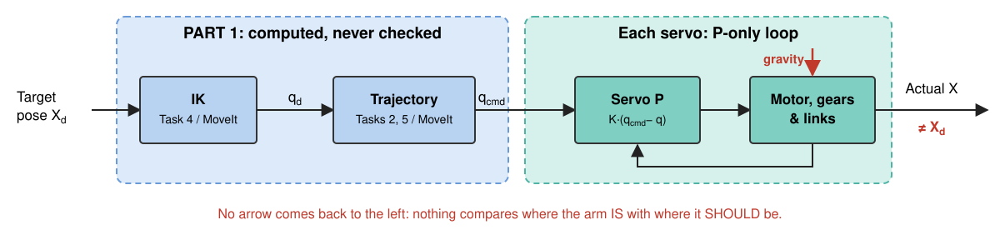
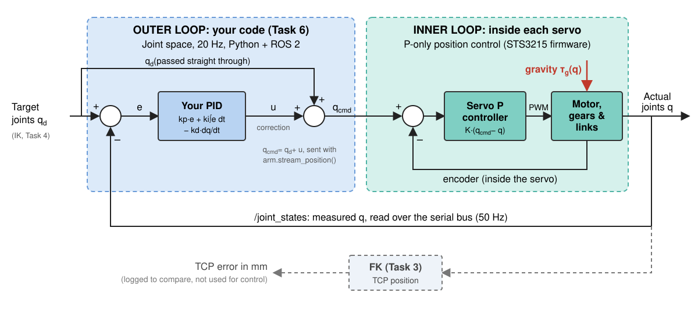

# Task 6: Closing the loop with a PID

**File:** `src/so100_labs/so100_labs/task6_pid_control.py`

## Why

Tasks 1–5 are **open loop**: IK gives joint angles, the controller sends them, and we _assume_ the
arm got there. Nothing checks.



Each servo holds its position with a **P-only** controller, `τ = K·(q_cmd − q)`. Holding the arm up
against gravity needs torque, so it needs an error. The joint settles at
`q = q_cmd + τ_g(q)/K`: 2–4° on the loaded joints, **1–3 cm** at the gripper.

## What you build

Measure the joints and correct the command until the measurement matches the target:



| Loop                    | Runs                            | Controller              | Fixes                         |
| ----------------------- | ------------------------------- | ----------------------- | ----------------------------- |
| Inner (green), provided | inside each servo               | P: `K·(q_cmd − q)`      | moves the motor fast          |
| Outer (blue), **you**   | `task6_pid_control.py`, 20 Hz   | PID per joint           | the sag the inner loop leaves |

`q_cmd = q_d + u`: the PID only adds a correction `u` on top of the target.

| Term | Output        | Effect                                                       |
| ---- | ------------- | ------------------------------------------------------------ |
| P    | `kp · e`      | reacts at once, but alone it can't remove the sag            |
| I    | `ki · ∫e dt`  | grows while there is an error, so it **removes** the sag     |
| D    | `−kd · dq/dt` | damps; on the measurement so a setpoint jump gives no "kick" |

**Anti-windup:** clamp the integral to `±integral_limit`, or a blocked arm builds up a huge
integral and jumps when released.

## What to implement

1. **EX1** `PID.update`: P + I (clamped) + D on the measurement, output clamped.
2. **EX2** `corrected_command`: `target + u` per joint, clipped to the joint limits.
3. **EX3** `hold_with_pid`: the control loop: measure, correct, `arm.stream_position(...)`.
4. **EX4** `KI`: tune it. Start with P only, then raise `ki`.

## Run it

```bash
pytest src/so100_labs/test/test_task6_pid_control.py
ros2 run so100_labs task6_pid_tune                    # step response on the servo model

ros2 launch so100_bringup arm.launch.py sag:=true     # terminal 1: mock arm that sags
ros2 run so100_labs task6_pid_control                 # terminal 2
```

```
ready  open loop  joint error [ 0.    -0.044 -0.058 -0.027 -0.001] (worst -3.3 deg) -> TCP off by 31.1 mm
ready  with PID   joint error [ 0.    -0.001 -0.001 -0.    -0.001] (worst -0.1 deg) -> TCP off by 0.7 mm
```

Plot the error live: `ros2 run rqt_plot rqt_plot /so100_labs/pid_error/data[1] /so100_labs/pid_error/data[2]`.
Real robot (no `sag:=true`): `bash scripts/run_on_robot.sh task6`.

## Your PID behind MoveIt

```bash
ros2 launch so100_bringup arm.launch.py rviz:=false sag:=true   # terminal 1
ros2 launch so100_bringup moveit.launch.py                      # terminal 2
ros2 run so100_labs task6_moveit_pid                            # terminal 3
```

Plan & Execute in RViz: the arm stops short, then your PID pulls it onto the target. Compare with
`ros2 param set /moveit_pid enabled false`.

## Think about it

- `kp` only vs `ki` only: which one does the real work against gravity, and why?
- The final `move_to(home)` is open loop again, so the arm sags. How would you run the PID during a
  whole trajectory?
- Gravity is predictable (`servo_model.gravity_torques`). What could **feed-forward** do, and what
  would the PID still be needed for?
